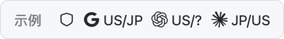
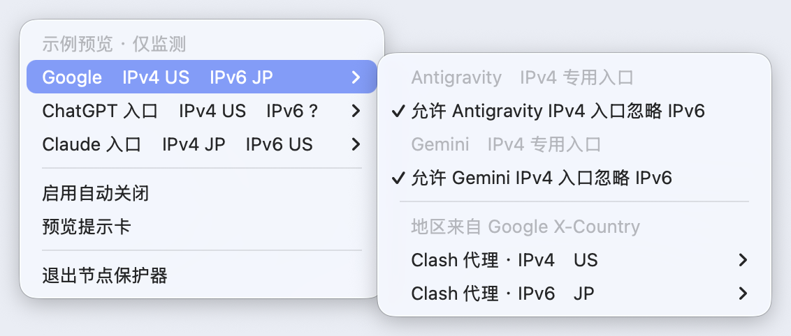
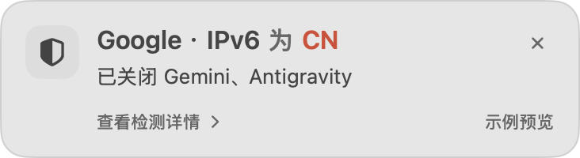

# NodeGuard · 节点保护器

[简体中文](README.md)

NodeGuard is a macOS menu bar app that checks IPv4 and IPv6 egress regions for Google, ChatGPT, and Claude separately. With automatic closing enabled, a `CN` reading affects only the desktop apps assigned to that service.



## Quick start

Use macOS 14 or later with Xcode Command Line Tools or Xcode. Run `xcode-select --install` if the command line tools are missing. Basic monitoring works without Clash.

From the repository directory, build and start in monitor-only mode.

```sh
./build.sh
open "./build/NodeGuard.app" --args --monitor-only
```

The build puts NodeGuard and two optional IPv4 launchers in `build/`, compiled for the local architecture and ad hoc signed. You can also open `build/NodeGuard.app` normally. It starts in monitor-only mode on first launch and saves your automatic closing preference. To see a sample card without starting network probes, launch in preview mode. In a running instance, select **预览提示卡** (Preview card) from the menu.

```sh
open "./build/NodeGuard.app" --args --preview
```

Save your work before selecting **启用自动关闭** (Enable automatic closing). NodeGuard may force-quit matched apps and identifiable helper processes, which can discard unsaved work. **暂停自动关闭** (Pause automatic closing) clears locks and keeps monitoring.

## Read the status

The menu bar shows Google, ChatGPT, and Claude from left to right. Every pair is **IPv4 / IPv6**, for example `US/JP`. Open a service submenu for per-route results. Where available, the route details show the egress IP, the destination IP, and the Clash connection chain. The shield changes when a service is locked. A card shows the triggering route, region, and closing results. To see the last card again, use the service submenu.





NodeGuard probes the local route, Clash when a listener is present at `127.0.0.1:7897`, and available macOS system proxy routes, including automatic proxy configuration. The local probe bypasses explicit proxies and can still pass through a TUN virtual network interface. NodeGuard drops a duplicate system proxy route when it matches the Clash listener. The address family identifies the probe destination. A proxy can listen on IPv4 loopback and reach an IPv6 destination. Clash chain details appear only when the controller socket can identify the probe connection. The decision uses the region reading. [Probe code](Probe.swift) · [Clash chain lookup](ClashConnection.swift)

| Service | Region signal and scope | Apps closed on `CN` |
| --- | --- | --- |
| Google | Reads `X-Country` from the final HTTPS response at the Chrome Variations endpoint on `clientservices.googleapis.com`, using fixed IPv4 and IPv6 destinations. The header reflects Google's region for that request. The response gives no client public IP. | Gemini and Antigravity only. |
| ChatGPT | Reads `loc` and `ip` from `chatgpt.com/cdn-cgi/trace` and checks the hostname and egress IP family. The signal comes from the website edge. | Matches the `com.openai.codex` desktop app and identifiable helpers. The UI calls this target ChatGPT (including Codex). |
| Claude | Reads `loc` and `ip` from `claude.ai/cdn-cgi/trace` and checks the hostname and egress IP family. The signal comes from the website edge. | Matches the `com.anthropic.claudefordesktop` desktop app and identifiable helpers. |

Each service detects, locks, and recovers independently. NodeGuard sends its own requests to the website edges and Chrome Variations. Desktop app traffic may take different routes. These readings leave sign-in status, model requests, and account region undetermined. ChatGPT and Claude destination lookups use Google DNS over HTTPS. The region comes from the respective trace response. [Service definitions](Service.swift) · [Process matching and closing](AgentCloser.swift)

- `CN` takes priority. Conflicting known regions appear as **多地** (multiple regions). A trailing `?` marks partial results, `?` alone means all paths are unknown, `—` means that family has no probe routes, and `…` appears while the app is waiting for its initial paths.
- Timeouts, network errors, and missing or invalid signals are unknown. An unknown reading alone can neither trigger closing nor clear a lock. While a lock is active, NodeGuard also applies the closing policy to newly detected matching processes.
- Google clears a lock one address family at a time. The affected family must still have active paths and all of them must return a known region other than `CN`. For ChatGPT and Claude, this condition applies to all active paths for the service and every path that contributed to its lock.

## Per-app IPv4 / IPv6 and the allowlist

The **launcher** directs a desktop app's traffic to its own local proxy. The **proxy and forwarding rules** restrict the address family of remote outbound connections. **NodeGuard** checks regions independently, recognizes specific launchers, and applies the closing policy. An allowlist entry controls closing only. Routing stays with the launcher and proxy.

### Use the two IPv4 examples

The optional launchers expect the official apps in `/Applications` and Clash Verge with TUN enabled. They must be able to read `/configs` and the TUN device name from the local Clash Verge controller socket. Each launcher starts its own mihomo process on a random loopback port and sends IPv4 connections through the current TUN. Clash applies its current routing rules. The launcher does not name or select a Clash node. Gemini also requires ProxyBridge and its enabled network extension.

1. Copy `Antigravity IPv4.app` or `Gemini IPv4.app` from `build/` to `~/Applications/` with its original name. An existing working launcher with that name can be reused. Save your work and quit the corresponding official app before reopening it through the IPv4 launcher.
2. Open the Google submenu and look for **IPv4 专用入口** (Dedicated IPv4 launcher) beside the app. Use **允许 Antigravity IPv4 入口忽略 IPv6** or **允许 Gemini IPv4 入口忽略 IPv6** to allow that verified launcher to ignore a Google IPv6 lock. Both checkboxes are on by default.
3. The exception applies only to a verified launcher instance when **Google is locked only for IPv6**. The closing policy still applies to ordinary instances, main processes that fail launcher recognition, and IPv4 launcher instances when Google has an IPv4 lock.

| Launcher | Traffic controls | What NodeGuard recognizes |
| --- | --- | --- |
| [Antigravity IPv4](Launchers/Antigravity.swift) | Passes a loopback HTTP proxy and `--disable-quic`. Sets the same proxy in environment variables for helpers that honor them. Components that ignore these settings may take other paths. | Checks installed executable paths, bundle IDs, and launch arguments. The supplied proxy port must match a launcher child process with the expected IPv4 configuration and an active listener. |
| [Gemini IPv4](Launchers/Gemini.swift) | Uses ProxyBridge to forward matching TCP and UDP to a dedicated SOCKS5 proxy. The proxy handles DNS and rejects other UDP and IPv6 targets. The launcher also applies a sandbox rule limiting Gemini's IPv6 egress. | Checks paths, bundle IDs, the common launcher parent of Gemini, ProxyBridge, and mihomo, and mihomo's IPv4 loopback listener. This checks process and listener state. Individual requests are outside its scope. |

### Customize a launcher and address family

1. Use a pattern from [Launchers/](Launchers/) that fits the target app. For apps and helpers that support proxies, adapt Antigravity's `originalID`, `originalURL`, and launch arguments. For process-based forwarding, adapt the app identifiers and bundle paths in Gemini's `startBridge`, along with its DNS, UDP and bypass handling. In the launcher section of [build.sh](build.sh), add the source file, bundle name, and a distinct bundle ID. A strict family restriction must cover helpers and block remote connections that bypass the forwarding rules.
2. Configure the dedicated proxy in the launcher's `startCore`. For IPv4, use `type: direct`, `ip-version: ipv4`, and IPv4 DNS as in the examples. For IPv6-only, use a working IPv6 route, a TUN that supports IPv6 egress, and DNS that returns AAAA records. Set the separate mihomo instance's `ipv6` and `dns.ipv6` to `true`, use `type: direct` with `ip-version: ipv6`, route traffic to that outbound, and reject IPv4 destinations and fallback. IPv4-only destinations will be unreachable. The local proxy may still listen on `127.0.0.1` because the family restriction concerns remote traffic. If adapting Gemini, update its DNS, forwarding, and sandbox settings to permit the intended IPv6 connections. Set up the dedicated proxy to use the current TUN without selecting a named Clash node. [mihomo outbound IP version](https://wiki.metacubex.one/en/config/proxies/#ip-version) · [mihomo DNS settings](https://wiki.metacubex.one/en/config/dns/#ipv6)
3. Register the launcher and official app paths and bundle IDs in [IPv4Entry.swift](IPv4Entry.swift). Match the expected process identity, parent-child relationships, listener and proxy configuration for that entry. To add an entry using the existing Google IPv4 policy, register the app and allowlist row in [AgentCloser.swift](AgentCloser.swift), rebuild, and use the Google submenu. For IPv6 or multiple launchers for one app, track verified instances and menu preferences by launcher and family in [AgentCloser.swift](AgentCloser.swift) and [Main.swift](Main.swift). Extend the policy in [Service.swift](Service.swift) so a verified IPv6 instance can be exempt only when Google is locked for IPv4 alone. A two-family lock allows no exception. To add an allowlist for another service, extend that service's closing policy.

The current menu has two Google IPv4 allowlist switches. IPv6-only setup requires a custom launcher and the source changes above. Confirm that the app's remote connections use the selected family before enabling its exception.

## Icon credits

The Google, OpenAI (ChatGPT), and Claude marks come from LobeHub's `@lobehub/icons-static-svg` 1.103.0. The original source references, Copyright (c) 2023 LobeHub, and the complete MIT notice remain in the individual SVG files under [Marks/](Marks/).
