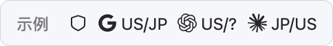
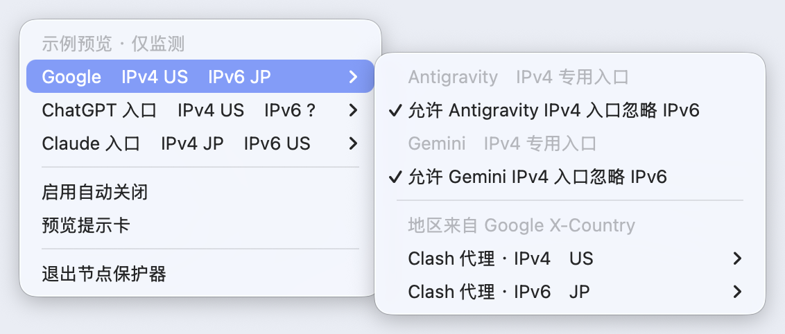
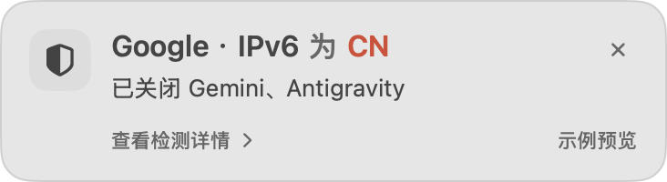

# NodeGuard · 节点保护器

[English](README.en.md)

NodeGuard 是一个 macOS 菜单栏应用。它分别探测 Google、ChatGPT 和 Claude 的 IPv4、IPv6 出口地区。启用自动关闭后，某家服务的检测返回 `CN` 时，NodeGuard 只处理该服务对应的桌面应用。



## 快速开始

需要 macOS 14 或更新版本，以及 Xcode 命令行工具或 Xcode。缺少命令行工具时可运行 `xcode-select --install`。基本监测无需安装 Clash。

在仓库目录构建并以仅监测模式启动：

```sh
./build.sh
open "./build/NodeGuard.app" --args --monitor-only
```

构建会在 `build/` 生成保护器和两个可选的 IPv4 启动器，使用本机架构和本地临时签名。平时可双击 `build/NodeGuard.app`，应用会记住自动关闭设置，首次启动默认仅监测。支持仅看示例卡片的预览模式。在已运行的实例中，直接点菜单里的「预览提示卡」即可。

```sh
open "./build/NodeGuard.app" --args --preview
```

保存工作后可在菜单中选择「启用自动关闭」。关闭动作可能强制终止匹配的应用及可识别的辅助进程，未保存的内容可能丢失。「暂停自动关闭」会清除锁定并继续监测。

## 查看状态

菜单栏从左到右是 Google、ChatGPT、Claude。每组都是 **IPv4 / IPv6**，例如 `US/JP`。点击状态图标，再展开服务子菜单，可看逐路径结果。有数据时可继续查看探测出口 IP、目标 IP 和 Clash 连接链。锁定时盾牌会改变。弹出的提示卡列出触发路径、地区和关闭结果，服务子菜单可重看最近一次提示。





探测包含本机路由（绕过显式系统代理，仍可能经过 TUN 虚拟网络接口）、本机 `127.0.0.1:7897` 有监听时的 Clash 代理，以及可用的系统代理或自动代理配置。相同的显式系统代理会去重。菜单中的地址族指探测目标所用的 IPv4 或 IPv6。本机代理监听地址可以是 IPv4，代理发往远端的连接仍可使用 IPv6。Clash 连接链仅在能从控制套接字匹配本次探测时显示，不参与触发判断。[探测实现](Probe.swift) · [Clash 连接链](ClashConnection.swift)

| 服务 | 地区信号与局限 | 返回 `CN` 时的关闭对象 |
| --- | --- | --- |
| Google | 向 Chrome Variations 的 `clientservices.googleapis.com` 固定 IPv4 / IPv6 目标发出 HTTPS 请求，读取最终响应的 `X-Country`。响应没有客户端公网 IP，地区表示 Google 对该探测请求的判断。 | Gemini、Antigravity。Google 的锁定只影响这两个应用。 |
| ChatGPT | 读取 `chatgpt.com/cdn-cgi/trace` 的 `loc` 和 `ip`，核对主机名和出口 IP 地址族。这是网站入口信号。 | 只匹配实现中 `com.openai.codex` 桌面应用及可识别的辅助进程。界面将该项显示为 ChatGPT（含 Codex）。 |
| Claude | 读取 `claude.ai/cdn-cgi/trace` 的 `loc` 和 `ip`，同样核对主机名和地址族。这是网站入口信号。 | 匹配 `com.anthropic.claudefordesktop` 桌面应用及可识别的辅助进程。 |

三个服务分别判断、锁定和恢复。网站入口与 Chrome Variations 的请求都由 NodeGuard 自己发出，实际应用流量可能走其他路径。这些信号也无法判断登录状态、模型请求结果或账号地区。ChatGPT 和 Claude 的目标地址经 Google DNS over HTTPS 查询，地区取自各自的 trace 响应。[服务定义](Service.swift) · [应用匹配与关闭](AgentCloser.swift)

- `CN` 优先显示。已知路径地区不一致时显示「多地」，有已知结果且仍有未知路径时加 `?`。全未知为 `?`，没有该族的探测路径为 `—`，首轮等待路径时为 `…`。
- 超时、网络不可用、缺失或无效信号都按未知处理。仅凭未知结果，既不会触发关闭，也不会解除已有锁定。锁定期间自动关闭会继续处理对应服务中新出现的匹配进程。
- Google 按地址族恢复。受影响的族须在当前仍有探测路径，且其当前路径全部明确返回非 `CN`。ChatGPT 和 Claude 要求该服务当前的路径及之前触发锁定的路径都明确返回非 `CN`。

## 单应用 IPv4 / IPv6 与白名单

**启动器**把指定桌面应用的流量交给该入口自己的本地代理。**代理和流量转发规则**限制远端出站地址族。**保护器**独立探测地区、识别启动入口，并按锁定状态决定是否关闭进程。白名单只改变关闭策略，启用它不会改变网络路由。

### 使用两个 IPv4 示例

可选启动器需要官方应用装在 `/Applications`、Clash Verge 已开启 TUN，且启动器可以通过 Clash Verge 的本机控制套接字读取 `/configs` 和 TUN 设备名。它们会分别启动独立的 mihomo 进程，在本机回环随机端口监听，按 IPv4 配置发往当前 TUN。出站仍由 Clash 当前路由规则决定，启动器不绑定节点名称。Gemini 还需要安装 ProxyBridge 并启用其网络扩展。

1. 将生成的 `Antigravity IPv4.app` 或 `Gemini IPv4.app` 从 `build/` 复制到 `~/Applications/`，沿用原名。已有同名可用入口时可直接使用。保存工作，退出相应官方应用后，从该 IPv4 启动器重开。
2. 打开 NodeGuard 的 Google 子菜单，核对对应应用显示「IPv4 专用入口」。分别通过「允许 Antigravity IPv4 入口忽略 IPv6」和「允许 Gemini IPv4 入口忽略 IPv6」启用或撤销例外。这两项首次运行默认勾选。
3. 例外仅在 Google **只有 IPv6 锁定**，且当前实例通过入口识别时生效。普通入口、无法确认归属的主程序，以及发生 Google IPv4 锁定时的 IPv4 入口仍按关闭策略处理。

| 入口 | 如何限制流量 | 保护器如何识别 |
| --- | --- | --- |
| [Antigravity IPv4](Launchers/Antigravity.swift) | 启动器传入回环 HTTP 代理参数和 `--disable-quic`，同时为支持代理环境变量的辅助进程提供相同代理。忽略这些设置的进程仍可能使用其他路径。 | 比对安装路径、应用标识和启动参数。代理参数里的端口必须对应启动器子进程的 IPv4 配置及实际监听。 |
| [Gemini IPv4](Launchers/Gemini.swift) | ProxyBridge 将匹配的 TCP 和 UDP 流量交给专用 SOCKS5 代理。代理处理 DNS、拒绝其余 UDP 和 IPv6 目标。启动器还用沙盒限制 Gemini 的 IPv6 出站。 | 核对路径和应用标识，检查 Gemini、ProxyBridge、mihomo 的共同启动器父进程，以及 mihomo 的本机 IPv4 TCP 监听。这项识别不检查每条实际请求。 |

### 自定义入口和地址族

1. 在 [Launchers/](Launchers/) 选与目标应用兼容的方式。应用及其辅助进程都支持代理时，可参考 Antigravity，修改 `originalID`、`originalURL` 和启动参数。需要进程级转发时，可参考 Gemini，修改 `startBridge` 中匹配的应用标识和安装路径，并按目标应用需要处理 DNS、UDP 和未被转发的连接。在 [build.sh](build.sh) 的启动器构建部分加入新源码、应用包名称和独立的应用标识。若目标是严格的单地址族，必须覆盖辅助进程并阻止未命中规则的远端直连。
2. 在启动器的 `startCore` 中配置专用代理。IPv4 可沿用 `type: direct`、`ip-version: ipv4` 和 IPv4 DNS。IPv6-only 需要可用的 IPv6 路由、支持 IPv6 出站的 TUN，以及能解析 AAAA 记录的 DNS。将独立 mihomo 配置中的 `ipv6` 和 `dns.ipv6` 设为 `true`，使用 `type: direct`、`ip-version: ipv6`，将流量匹配到该出口并拒绝 IPv4 目标与 IPv4 回退。只提供 IPv4 的目标会无法连接。回环代理仍可监听 `127.0.0.1`，地址族限制应施加到远端连接。若从 Gemini 示例修改，还要调整 DNS、转发与沙盒规则，避免原有 IPv6 禁令。设置放在独立代理中，无需指定 Clash 节点或改动全局地址族策略。[mihomo 出站地址族](https://wiki.metacubex.one/en/config/proxies/#ip-version) · [mihomo DNS 配置](https://wiki.metacubex.one/en/config/dns/#ipv6)
3. 在 [IPv4Entry.swift](IPv4Entry.swift) 登记启动器和官方应用的路径、应用标识，并按实际启动方式检查进程身份、父子关系、监听端口及代理配置。只使用现有 Google IPv4 方式时，在 [AgentCloser.swift](AgentCloser.swift) 登记目标应用与白名单条目，重编译后可用 Google 子菜单控制。新增 IPv6 或为同一应用提供多个入口时，还要让识别结果及菜单开关区分每个入口及其地址族（[AgentCloser.swift](AgentCloser.swift) · [Main.swift](Main.swift)），并扩展 [Service.swift](Service.swift) 的例外条件，使已确认的 IPv6 入口仅在 Google 只有 IPv4 锁定时获得例外。双族锁定时不豁免。其他服务若要支持白名单，需为对应服务新增关闭例外策略。

现有菜单提供两个 Google IPv4 入口的开关。IPv6-only 需要自建入口和上述源码扩展，并确认目标应用的远端流量确实受所选地址族约束后，再启用对应例外。

## 图标署名

Google、OpenAI（ChatGPT）与 Claude 标志来自 LobeHub 的 `@lobehub/icons-static-svg` 1.103.0。原始来源、Copyright (c) 2023 LobeHub 和 MIT 许可全文保留在 [Marks/](Marks/) 的各个 SVG 文件中。
